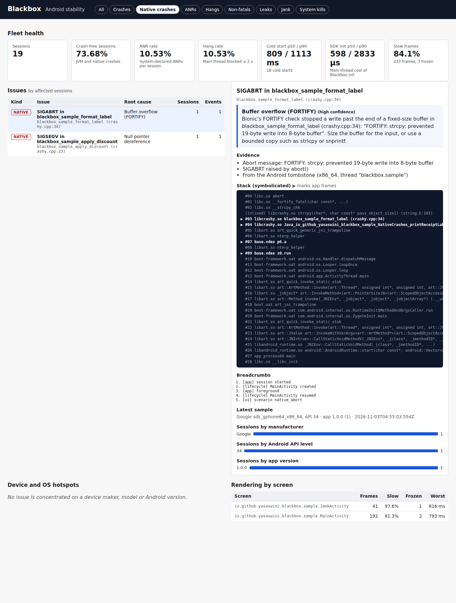
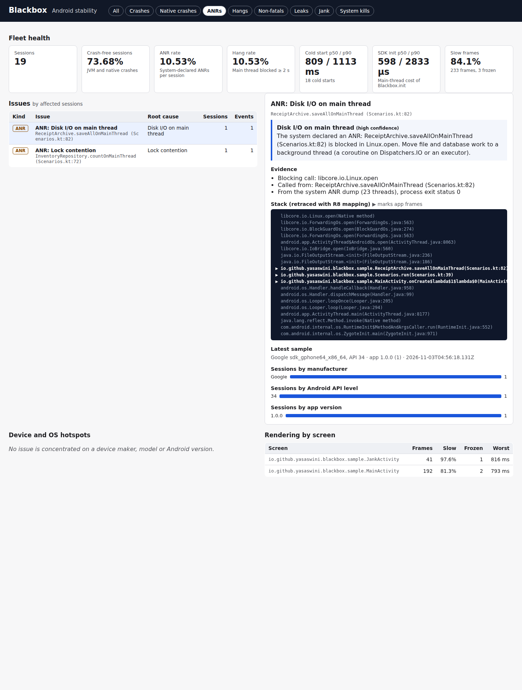
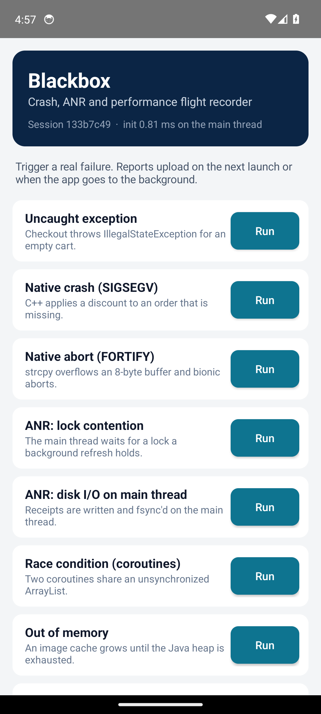

# Blackbox

[](https://github.com/yasaswinivardhireddy-png/blackbox-android/actions/workflows/ci.yml)

Blackbox is a small "flight recorder" for Android apps. It has two parts:

- **An Android SDK** (Kotlin, with a C++ signal handler built with the NDK). It records JVM and native crashes, ANRs, main-thread hangs, slow and frozen frames, leaked Activities, startup time and system process kills. It is built to stay out of the app's way: there are no third-party dependencies, almost nothing runs on the main thread, and the code is small after R8.
- **A triage server** (TypeScript on Node.js, built-in SQLite, no runtime dependencies). It turns raw reports into readable issues. It retraces R8-obfuscated stacks, symbolicates native frames, decodes Android tombstones and ANR thread dumps, and groups duplicates. It explains the likely root cause (for example *deadlock*, *disk I/O on the main thread* or *FORTIFY buffer overflow*) and flags issues concentrated on one device maker, model or Android version.

CI builds the release app and runs every failure scenario of the sample app on an Android 14 emulator. It then checks that the server diagnosed each one correctly.

| Native crash, symbolicated from the tombstone | ANR, retraced from the system thread dump | Sample app |
|---|---|---|
|  |  |  |

## What it catches

| Problem | How the SDK captures it | What the server concludes |
|---|---|---|
| JVM crash | Uncaught-exception handler that writes the report synchronously before the process dies: exception chain, all thread stacks, heap usage, breadcrumbs | Retraces R8 stacks, including inline frames, synthesized lambdas and `rewriteFrame` rules. Classifies races (with the concurrent thread), OOM, lifecycle misuse, platform behavior changes, null dereferences and failed preconditions |
| Native crash (C/C++) | `sigaction` handler on an alternate stack with an async-signal-safe writer: signal, fault address, `_Unwind_Backtrace` frames with module build IDs, native breadcrumbs. It then re-raises to debuggerd, so Android still writes its tombstone. On Android 12+, the tombstone is read back from `ApplicationExitInfo` | Symbolicates by build ID with `llvm-symbolizer`, including inlined functions. Decodes tombstone protobufs. Classifies null dereferences, FORTIFY aborts, heap corruption and OEM-library crashes. Counts a crash once, although it arrives from both the handler and the tombstone |
| ANR | `ApplicationExitInfo` with `REASON_ANR` and the system's thread dump (Android 11+) | Builds the lock-owner graph (lock contention or deadlock, naming the owner thread). Applies blocking-call rules: disk, network, Binder, `SharedPreferences` flush, sleep, wait |
| Main-thread hang | A watchdog thread posts a reused `Runnable` to the main `Looper` every 500 ms. When it is not run within 2 s, the watchdog samples the main thread's stack until the hang ends | Votes over the samples to find where the time went |
| Jank | `FrameMetrics` per Activity visit: slow frames miss the vsync deadline, frozen frames take 700 ms or more | Rates per screen |
| Leaks | Weak references to destroyed Activities, checked after a delay and a forced GC | The leaked class and how long it was retained |
| Startup | Process start to first drawn frame, cold or warm, plus the SDK's own init time | p50 and p90 |
| System kills | `ApplicationExitInfo`: low-memory kills, excessive resource use, signals | The kill reason and the process importance at the time |

## Measured results

All numbers come from CI runs on GitHub-hosted runners; the workflow logs and artifacts hold the raw output.

| What | Result | How |
|---|---|---|
| End-to-end diagnosis | **12/12 scenarios** reported with the right root cause and source line, for example `crashy.cpp:23` for the SIGSEGV and `Scenarios.kt:53` for the R8-inlined crash. Each native crash is counted once, although it arrives twice | Release (R8) app on an Android 14 emulator: `scripts/e2e.sh`, then `server/scripts/e2e-verify.ts` |
| SDK init on the main thread | **p50 0.60 ms, p90 1.0 ms** over 19 cold starts; 7.5 ms on the first launch after install | `Blackbox.init took` log lines, and the `Blackbox.*` Perfetto slices from `trace_processor` |
| SDK size | **145 methods, 25.3 KB of dex** after R8; `libblackbox.so` 21.5–39.2 KB per ABI; no dependencies beyond the Kotlin standard library | `scripts/size-report.sh` (apkanalyzer with the R8 mapping) |
| Ingestion | **13,706 reports/s**, p99 92.5 ms, 0 errors (16 connections, gzip batches of 25, SQLite in WAL mode, separate server process) | `npm run loadtest` |
| Hotspot detection | **100% precision** at 5k, 20k and 50k sessions per run. Recall is 100% at 20k and 50k, and 50% at 5k, because defects with fewer than 20 affected sessions are not judged | `npm run fleet`: 10 seeded runs per size, synthetic sessions with six injected defects |
| Tests | 30 SDK unit tests, 6 instrumented tests on the emulator, 37 server tests | CI |

### What the measurements changed

- **Main-thread init.** The first emulator run measured `Blackbox.init` at 6.2 ms p50 and 35 ms p90. Perfetto showed 35 ms of a 38 ms init spent in `ActivityManager.getMyMemoryState`, a Binder call made while system_server was busy starting the app. A first-post check now detects cold starts without IPC, which brought p50 to 1.5 ms. The remaining slow launches (19 to 58 ms) waited in `HandlerThread.getLooper()` for a background-priority thread right after crashes and ANRs: a priority inversion. The main thread now never waits for the SDK's threads, the disk or a system service, which brought the numbers to 0.60 ms p50 and 1.0 ms p90.
- **Race detection.** On the emulator, the coroutine race crashed with a `NullPointerException`, not a `ConcurrentModificationException`. At that moment the writer thread was inside `ArrayList.add`. Background NPEs and index errors with a concurrent thread in the same class are now classified as races, and that real crash is a regression test.
- **Ingestion.** One commit per batch, with a savepoint per report, raised throughput 2.6x on a laptop (3.4k to 8.9k reports/s).

## Architecture

```
 Android app process                                   Triage server (Node.js, SQLite)
 ┌────────────────────────────────────────────┐       ┌──────────────────────────────────────────┐
 │ Blackbox.init (main thread, about 1 ms at  │       │ POST /v1/reports  (gzip, API key,        │
 │ p90): crash handler, lifecycle callbacks,  │       │   idempotent, one commit per batch)      │
 │ watchdog and frame threads                 │       │   ├─ R8 retrace (mapping per build)      │
 │                                            │ gzip  │   ├─ native symbolication (build ID)     │
 │ blackbox-io thread: native handler install,│ JSON  │   ├─ tombstone / ANR dump decoding       │
 │ exit reasons, native crash files, uploads  ├──────►│   ├─ root-cause rules, fingerprinting    │
 │                                            │ batch │   └─ native crash + tombstone merge      │
 │ Report store: atomic files, priority-based │       │ GET  /v1/issues, /v1/hotspots, /overview │
 │ trimming, retry with jittered backoff      │       │ Dashboard, /metrics (Prometheus format)  │
 │                                            │       │ Hotspots: Wilson lower bound per maker,  │
 │ libblackbox.so: signal handler (C++)       │       │   model, Android version and their mix   │
 └────────────────────────────────────────────┘       └──────────────────────────────────────────┘
```

## Design notes and trade-offs

- **Main-thread budget.** `Blackbox.init` only installs handlers, starts two threads and registers callbacks. It never waits for those threads, the disk or a system service. Disk and IPC work goes into objects created on first use, normally on the SDK's background thread. That thread starts its own work once its Looper is ready, and a latch orders it after main-thread init. Init time and a per-phase breakdown are recorded on every launch (`adb shell setprop log.tag.Blackbox DEBUG` logs them). Trace sections (`Blackbox.init`, `Blackbox.install`, `Blackbox.backgroundInit`, `Blackbox.upload`) make the SDK visible in Perfetto.
- **No allocation while healthy.** The watchdog reuses one `Runnable` and sleeps while the app is in the background. Frame statistics use fixed buckets. IDs come from `ThreadLocalRandom`, so there is no `SecureRandom` seeding on the main thread.
- **Native crash handling is best effort; the tombstone is the source of truth.** The handler does not allocate, lock or use stdio. It writes a line-oriented file with `write(2)`, which Kotlin converts on the next launch. `dladdr` and `_Unwind_Backtrace` can still take the dynamic linker's lock, so a crash inside the linker could hang the handler. A production SDK would unwind from a separate process, as Crashpad does. On Android 12 and later, the server prefers the tombstone that debuggerd collects out of process, and merges the two reports into one occurrence.
- **Delivery.** Reports are written atomically and uploaded in gzip batches of up to 25 reports or 768 KB. Retries use exponential backoff with jitter. The store keeps crashes over sessions when space runs out. Ingestion is idempotent, so a retried batch never double-counts. A hang report that was rewritten while the hang continued replaces the shorter version.
- **Grouping.** Fingerprints use the exception type and the top in-app frames after retrace, with lambda and anonymous-class numbering normalized. An obfuscated crash and its readable equivalent therefore land in the same issue.
- **Hotspots.** For each issue, the server compares each segment's share of affected sessions with its share of all sessions. A segment is flagged only when it holds most affected sessions and the Wilson 95% lower bound of its share is at least twice its fleet share. A fleet-wide bug is therefore never blamed on the most popular phone. Issues with fewer than 20 affected sessions are not judged.

## Run it

Requirements: JDK 17+, Android SDK (platform 36, NDK 27.3, CMake 3.31) and Node.js 22.18+.

```bash
./gradlew :blackbox:testDebugUnitTest :sample:assembleRelease     # SDK unit tests, release app
cd server && npm ci && npm test && npm start                        # server and dashboard on :8080
npm run fleet && npm run loadtest                                   # fleet simulation, load test
./scripts/e2e.sh                                                    # needs a running x86_64 emulator
```

Use the SDK:

```kotlin
class App : Application() {
    override fun onCreate() {
        super.onCreate()
        Blackbox.init(this, BlackboxConfig(endpoint = "https://blackbox.example.com", apiKey = "..."))
    }
}
Blackbox.breadcrumb("Tapped checkout", "ui")
Blackbox.recordNonFatal(e)
```

Upload the R8 mapping and the unstripped native libraries for each release so the server can retrace and symbolicate:

```bash
curl -X POST -H "authorization: Bearer $KEY" --data-binary @mapping.txt "$URL/v1/mappings?version=1.0.0&build=1"
curl -X POST -H "authorization: Bearer $KEY" --data-binary @libcrashy.so "$URL/v1/symbols?name=libcrashy.so"
```

## Repository layout

| Path | Contents |
|---|---|
| `blackbox/` | The SDK: Kotlin sources, the C++ signal handler, JVM unit tests and instrumented tests |
| `sample/` | A release (R8) app with ten real failure scenarios, including native code built with `_FORTIFY_SOURCE` |
| `server/` | Ingestion, retrace, symbolication, analysis, hotspots, dashboard, tests, fleet simulation and load test |
| `scripts/` | The emulator end-to-end run and the size report |

## Limits

- Measurements come from an emulator in CI and a laptop, not from a production fleet. The fleet simulation uses synthetic sessions with seeded defects, which shows the detector's precision and sample-size needs, not real-world prevalence.
- ANR traces and tombstones depend on `ApplicationExitInfo`: ANR traces need Android 11+, and tombstones need Android 12+. Older versions still get the in-process watchdog and signal handler.
- The watchdog cannot see lock owners. For hangs it infers the likely owner from threads running code of the same class; system ANR dumps name it exactly.

MIT licensed.
